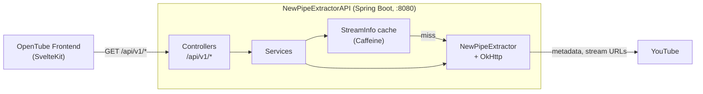

# NewPipeExtractorAPI

[](https://github.com/kl3pt0gr4ph/NewPipeExtractorAPI/actions/workflows/maven.yml)
[](https://github.com/kl3pt0gr4ph/NewPipeExtractorAPI/releases)
[](https://hub.docker.com/r/mrtumble/opentube-backend)

A Spring Boot REST API that wraps the [NewPipeExtractor](https://github.com/TeamNewPipe/NewPipeExtractor) library to serve YouTube metadata, search, channels, playlists, comments and DASH manifests as JSON.

This is the backend for [OpenTube](https://github.com/kl3pt0gr4ph/OpenTube-Frontend), but works as a standalone API. It does the extraction; the frontend serves the app, forwards API calls to it, and proxies the media. It is meant to run on a private network behind the frontend, not on the public internet.

---

## Contents

- [How it works](#how-it-works)
- [Quick start](#quick-start)
- [API reference](#api-reference)
- [Configuration](#configuration)
- [Deployment](#deployment)
- [Development](#development)
- [Testing](#testing)
- [Versioning and releases](#versioning-and-releases)
- [Contributing](#contributing)
- [Related projects](#related-projects)

## How it works



Each controller turns the request's `id` into a YouTube URL, a service extracts it with NewPipeExtractor, and the result goes back as JSON. The backend never touches media: the frontend fetches every video segment itself, through its own proxy.

### DASH manifests

`GET /api/v1/streams/dash` returns an on-demand DASH manifest describing **every** playable stream. The backend doesn't pick qualities, codecs or languages; the player does, from what the manifest offers.

1. **Filter.** `DashPlayabilityFilter` is the only place streams are removed, and every rule is about whether a player could use them:
   - Video and audio need a progressive HTTP URL, a MIME type, a codec, and init and index byte ranges, so they can be written as `SegmentBase` representations.
   - Subtitles must be VTT or TTML, with one serialisation kept per track. Manual and auto-generated tracks in the same language are both kept.
2. **Generate.** `DashManifestGeneratorService` groups what's left into AdaptationSets:

   | Content   | One AdaptationSet per         | Labelled with                                                       |
      | --------- | ----------------------------- | ------------------------------------------------------------------- |
   | Video     | Container and codec family    | Representations sorted by height, highest first                     |
   | Audio     | Track, then container and codec | `lang`, a `Role` and a `<Label>`; representations by bandwidth   |
   | Subtitles | Track                         | `lang`, a `subtitle` or `caption` Role and a `<Label>`              |

   Audio Roles come from YouTube's track type: original → `main`, dubbed → `dub`, descriptive → `description`, anything else → `alternate`. An untyped track is `main` when it's the only one. Labels use YouTube's track name, then the language name; a track with neither is labelled `Original` if it's the main track and `Unknown` otherwise. Auto-generated subtitles get an `(auto-generated)` suffix.

A trimmed example of one audio track:

```xml
<AdaptationSet id="1" contentType="audio" mimeType="audio/mp4" lang="en" subsegmentAlignment="true" startWithSAP="1">
  <Role schemeIdUri="urn:mpeg:dash:role:2011" value="main"/>
  <Label>English original</Label>
  <Representation id="140" bandwidth="130482" codecs="mp4a.40.2" audioSamplingRate="44100">
    <AudioChannelConfiguration schemeIdUri="urn:mpeg:dash:23003:3:audio_channel_configuration:2011" value="2"/>
    <BaseURL>https://rr3---sn-example.googlevideo.com/videoplayback?…</BaseURL>
    <SegmentBase indexRange="601-900">
      <Initialization range="0-600"/>
    </SegmentBase>
  </Representation>
</AdaptationSet>
```

### Muxed fallback

Some videos have no adaptive streams that pass the filter, for example SABR-restricted ones. When there isn't at least one playable video **and** one playable audio stream, `/streams/dash` falls back to a single progressive MP4 that a plain `<video>` element can play:

| Outcome                          | Status | `Content-Type`          | Body                                       |
| -------------------------------- | ------ | ----------------------- | ------------------------------------------ |
| Manifest built                   | `200`  | `application/dash+xml`  | The MPD                                    |
| No manifest, muxed stream exists | `200`  | `text/uri-list`         | One URL followed by `\r\n`                 |
| Nothing playable                 | `503`  | `application/json`      | Error with code `NO_STREAMS_AVAILABLE`     |

Clients should check `Content-Type`, not the body, to tell a manifest from a fallback.

### Stream info cache

Every `/streams/*` endpoint for a video reads the same extracted `StreamInfo`, cached in memory with Caffeine. A watch page that asks for details, thumbnails, related items and the manifest costs one extraction, not four.

An entry lives until shortly before the signed stream URLs inside it stop working:

- **Normal:** until the earliest `expire=` timestamp across the stream URLs, minus a 10-minute safety margin, capped at 6 hours.
- **No `expire` found:** 5 minutes.
- **Degraded** (no video-only or audio streams at all): 30 seconds, so a bad extraction isn't pinned for hours.

If YouTube returns a valid video with no adaptive streams, extraction is retried once before caching. The cache holds 300 entries by default, is per instance, and is empty after a restart. All of these values can be changed; see [Configuration](#configuration).

## Quick start

You need Docker.

```bash
docker run --rm -p 8080:8080 mrtumble/opentube-backend:latest
curl 'http://localhost:8080/api/v1/streams/details?id=dQw4w9WgXcQ'
```

To run it with the frontend, use the compose file in the [frontend README](https://github.com/kl3pt0gr4ph/OpenTube-Frontend#quick-start). The backend doesn't need to be published to the host there; only the frontend talks to it.

## API reference

All endpoints are `GET`, live under `/api/v1`, and return JSON unless noted. Paginated responses include a `nextPage` object; pass its fields back **verbatim** to the matching `/page` endpoint, since YouTube's continuation tokens only work unmodified.

### Streams

`id` is a video ID, e.g. `dQw4w9WgXcQ`. All of these share the [stream info cache](#stream-info-cache).

| Endpoint                  | Returns                                                                       |
| ------------------------- | ----------------------------------------------------------------------------- |
| `/streams/details`        | Title, description, channel, view and like counts, upload date               |
| `/streams/dash`           | DASH manifest, or the [muxed fallback](#muxed-fallback)                       |
| `/streams`                | NewPipe's full `StreamInfo`                                                    |
| `/streams/audio`          | Audio streams                                                                 |
| `/streams/video`          | Video-only streams                                                            |
| `/streams/video/dash`     | YouTube's own DASH MPD URL, when it has one (plain string)                    |
| `/streams/subtitles`      | Subtitle tracks                                                               |
| `/streams/thumbnails`     | Thumbnails                                                                    |
| `/streams/description`    | Description                                                                   |
| `/streams/segments`       | Chapters                                                                      |
| `/streams/preview-frames` | Storyboard frames for seek previews                                           |
| `/streams/related`        | Related videos, playlists and channels                                        |

### Search

| Endpoint       | Parameters                                                                                  |
| -------------- | ------------------------------------------------------------------------------------------- |
| `/search`      | `searchString`; optional `sortFilter` and `contentFilters` (comma-separated)                |
| `/search/page` | `searchString`, `pageUrl`, optional `pageId`, and the same filters as the first request     |

Results mix videos, channels and playlists (see each item's `type`), with duplicates removed by URL.

### Channels

`id` is the part of the channel URL after `youtube.com/`, e.g. `@LinusTechTips` or `channel/UC…`.

| Endpoint             | Parameters                                                                                          |
| -------------------- | --------------------------------------------------------------------------------------------------- |
| `/channels`          | `id`. Name, avatars, banners, description, subscriber count and available tabs                       |
| `/channels/tab`      | `id`, `tab`: `videos` (default), `shorts`, `livestreams` or `playlists`                              |
| `/channels/tab/page` | `channelId`, `tab`, `pageUrl`, `pageBody`, and `pageIds` repeated three times, all from `nextPage`  |

### Playlists and comments

| Endpoint          | Parameters                                                    |
| ----------------- | ------------------------------------------------------------- |
| `/playlists`      | `id`, the playlist ID (`PL…`)                                 |
| `/playlists/page` | `url`, the full playlist URL, and `pageUrl` from `nextPage`   |
| `/comments`       | `id`, a video ID                                              |
| `/comments/page`  | `id` and `pageUrl` from `nextPage`                            |

### Kiosks

| Endpoint             | Returns                                         |
| -------------------- | ----------------------------------------------- |
| `/kiosks`            | The kiosk IDs YouTube offers                    |
| `/kiosks/{kioskId}`  | Kiosk name and its items, e.g. `trending_music` |

Kiosks are a single page; there is no `/page` endpoint. The category kiosks (`trending_music`, `trending_gaming`, `trending_movies_and_shows`) work. The general `Trending` kiosk currently fails, because YouTube retired that page.

### Other

| Endpoint           | Returns                                                         |
| ------------------ | --------------------------------------------------------------- |
| `/services`        | The streaming services NewPipeExtractor supports                |
| `/actuator/health` | Health status with details. Not under `/api/v1`. Used by the Docker `HEALTHCHECK`. |

### Errors

Errors share one shape:

```json
{
  "timestamp": "2026-10-29T10:30:00.123Z",
  "status": 400,
  "error": "Bad Request",
  "message": "Required parameter 'id' is missing",
  "errorCode": "MISSING_PARAMETER",
  "path": "/api/v1/streams/details"
}
```

| `errorCode`            | Status | Cause                                                           |
| ---------------------- | ------ | --------------------------------------------------------------- |
| `MISSING_PARAMETER`    | `400`  | A required parameter is absent                                  |
| `VALIDATION_ERROR`     | `400`  | A parameter is empty or doesn't form a valid YouTube URL        |
| `EXTRACTION_ERROR`     | `500`  | NewPipeExtractor failed: video unavailable, YouTube changed, network error |
| `NO_STREAMS_AVAILABLE` | `503`  | `/streams/dash` found nothing playable, not even a muxed stream |
| `INTERNAL_ERROR`       | `500`  | Anything unexpected                                             |

## Configuration

Any Spring Boot property can be set as an environment variable. These are the ones that matter:

| Variable                                    | Default | Description                                                                                       |
| ------------------------------------------- | ------- | ------------------------------------------------------------------------------------------------- |
| `SERVER_PORT`                               | `8080`  | Port the API listens on. The image's `HEALTHCHECK` follows it.                                    |
| `SPRING_PROFILES_ACTIVE`                    | –       | `local` turns on `DEBUG` logging for the API's own packages. It's the only profile.               |
| `LOGGING_LEVEL_ORG_EXAMPLE_API`             | `INFO`  | Log level for the API's packages, without switching profile. NewPipe itself logs at `WARN`.       |
| `OPENTUBE_CACHE_STREAMINFO_MAXENTRIES`      | `300`   | Maximum cached videos.                                                                            |
| `OPENTUBE_CACHE_STREAMINFO_SAFETYMARGIN`    | `10m`   | How long before the stream URLs expire an entry is dropped.                                       |
| `OPENTUBE_CACHE_STREAMINFO_FALLBACKTTL`     | `5m`    | Lifetime when no `expire` timestamp is found.                                                     |
| `OPENTUBE_CACHE_STREAMINFO_DEGRADEDTTL`     | `30s`   | Lifetime of an extraction with no adaptive streams.                                               |
| `OPENTUBE_CACHE_STREAMINFO_MAXTTL`          | `6h`    | Upper bound on any entry's lifetime.                                                              |
| `JDK_JAVA_OPTIONS`                          | –       | Extra JVM flags. They take precedence over the image's defaults (see [Memory](#memory)).          |

Durations use Spring's format: `30s`, `10m`, `6h`. In `application.properties` the cache settings are `opentube.cache.streaminfo.max-entries`, `safety-margin` and so on.

CORS (any origin on `/api/**`) and the HTTP client timeouts (30 s connect and read) are fixed in code.

## Deployment

### Docker image

Images are published to Docker Hub as [`mrtumble/opentube-backend`](https://hub.docker.com/r/mrtumble/opentube-backend), tagged from git tags (`1.2.3`, `1.2`, `1`, `latest`).

The image runs as an unprivileged user (UID `1001`), listens on `8080`, and checks its own health at `/actuator/health`. On `docker stop`, Java receives the signal directly and shuts down gracefully.

### Memory

The heap is sized from the container's memory limit, at 75% of it. **Set a limit:** without one, the JVM sizes the heap from the host's RAM. The image also pins the G1 collector and exits on an out-of-memory error, so the restart policy brings the container back.

To change a JVM setting for one deployment, set `JDK_JAVA_OPTIONS`, e.g. `-XX:MaxRAMPercentage=70`.

### Compose

```yaml
services:
  backend:
    image: mrtumble/opentube-backend:latest
    restart: unless-stopped
    read_only: true
    tmpfs:
      - /tmp
    cap_drop:
      - ALL
    security_opt:
      - no-new-privileges:true
```

Don't add a `healthcheck:` block unless you need different timings: the one in the image is used automatically.

### Keep it private

Don't publish the backend's port. CORS allows any origin, and the health endpoint shows details, because the backend is designed to be reached only by the frontend on a private network.

### Run the frontend and backend from the same network

YouTube binds the `googlevideo.com` URLs it hands out to the IP address that requested them. The backend extracts the URLs and the frontend fetches the media, so both must reach the internet from the **same public IP**. Running them on the same host satisfies this.

## Development

### Prerequisites

- JDK 25
- Maven 3.9+

### Setup

```bash
git clone https://github.com/kl3pt0gr4ph/NewPipeExtractorAPI.git
cd NewPipeExtractorAPI/app
mvn spring-boot:run
```

The API is at <http://localhost:8080>. To log at `DEBUG`, run with the `local` profile:

```bash
mvn spring-boot:run -Dspring-boot.run.profiles=local
```

NewPipeExtractor comes from JitPack, which the POM already lists as a repository.

### Building

```bash
mvn package -DskipTests          # from app/: produces target/api-<version>.jar
docker build -t opentube-backend .   # from the repository root
```

### Logging

Log lines follow this pattern:

```
10:30:00:123 INFO  3f9a1c2e dQw4w9WgXcQ o.e.a.service.VideoStreamingService - Extracted streams for URL: …
```

The two IDs after the level are a short `requestId` for each request, and the request's `id` parameter as `resourceId`, so every line from one request can be found with one search.

When adding logging, follow the conventions the code already uses:

- **`DEBUG`** for entry lines, e.g. a controller receiving a request.
- **One `INFO` line** when an operation completes, with what it produced.
- **`WARN`** for degraded but handled outcomes, such as a retry or the muxed fallback.
- **No log-and-throw.** Throw, and let `GlobalExceptionHandler` log the error once as it builds the response.

## Testing

```bash
mvn test                                                   # unit tests
mvn test -Dtest=StreamingControllerTest                    # one class
mvn test -Dtest='StreamingControllerTest#propagatesFailuresToAdvice'   # one method
mvn verify                                                 # unit and integration tests
```

Run these from `app/`.

- **Unit tests** run with Surefire and are hermetic: NewPipeExtractor calls are mocked and HTTP is faked with MockWebServer. JaCoCo writes a coverage report to `target/site/jacoco/index.html`; no thresholds are enforced.
- **Integration tests** (`*IT.java`, under `integration/`) run with Failsafe. They start the whole application and call YouTube for real, so they need network access and can fail when YouTube changes.

CI runs the unit tests on every push and pull request to `main`, and uploads the results and coverage report.

## Versioning and releases

Versioning follows [Semantic Versioning](https://semver.org). The rule of thumb: if the person deploying it has to change anything, it's a major release.

Releases are cut by pushing an annotated `vX.Y.Z` tag. The publish workflow checks that the version in `app/pom.xml` matches the tag, builds and pushes the Docker image, and creates a GitHub Release from the matching [CHANGELOG.md](CHANGELOG.md) section. The full procedure is in [VERSIONING.md](VERSIONING.md).

## Contributing

Issues and pull requests are welcome.

1. Open or pick up an issue first, so the change is agreed before work starts. Each pull request should close one issue.
2. Branch from `main` using `feat/…`, `fix/…`, `refactor/…`, `chore/…` or `docs/…`.
3. Make sure `mvn test` passes from `app/` before opening the pull request.
4. Add a line under `## [Unreleased]` in [CHANGELOG.md](CHANGELOG.md) for any user-visible change.

## Related projects

- [OpenTube Frontend](https://github.com/kl3pt0gr4ph/OpenTube-Frontend): the SvelteKit app that talks to this API
- [NewPipeExtractor](https://github.com/TeamNewPipe/NewPipeExtractor): the extraction library underneath it
- [NewPipe](https://github.com/TeamNewPipe/NewPipe): the Android app NewPipeExtractor was built for

OpenTube is an independent project and is not affiliated with, endorsed by or connected to YouTube or Google.